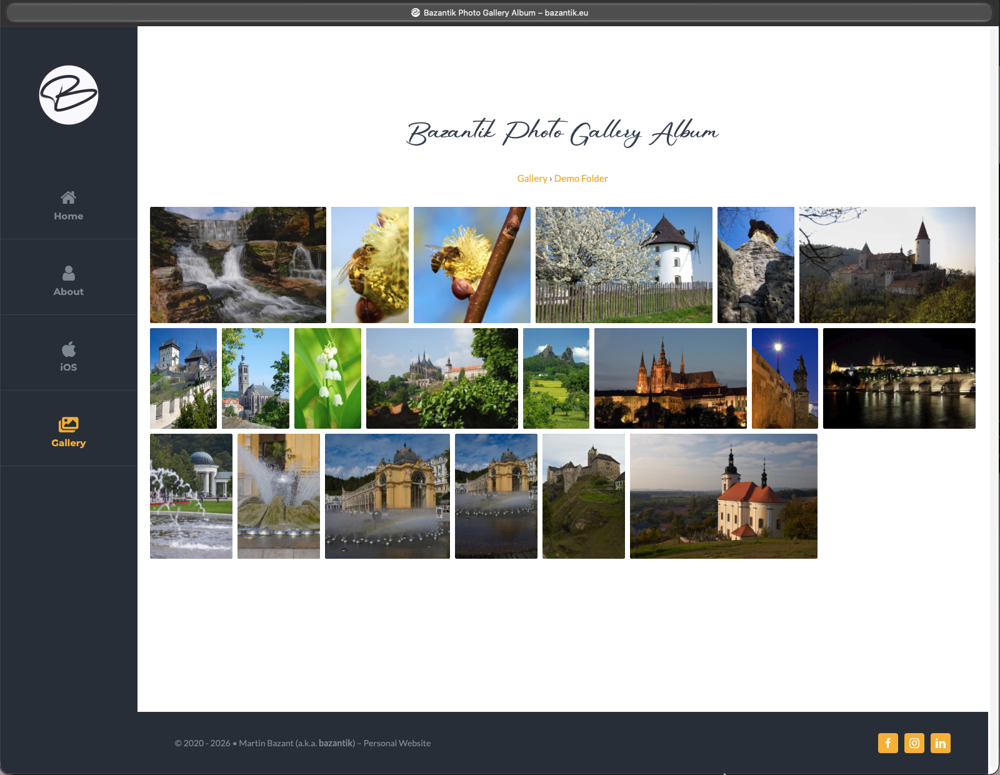
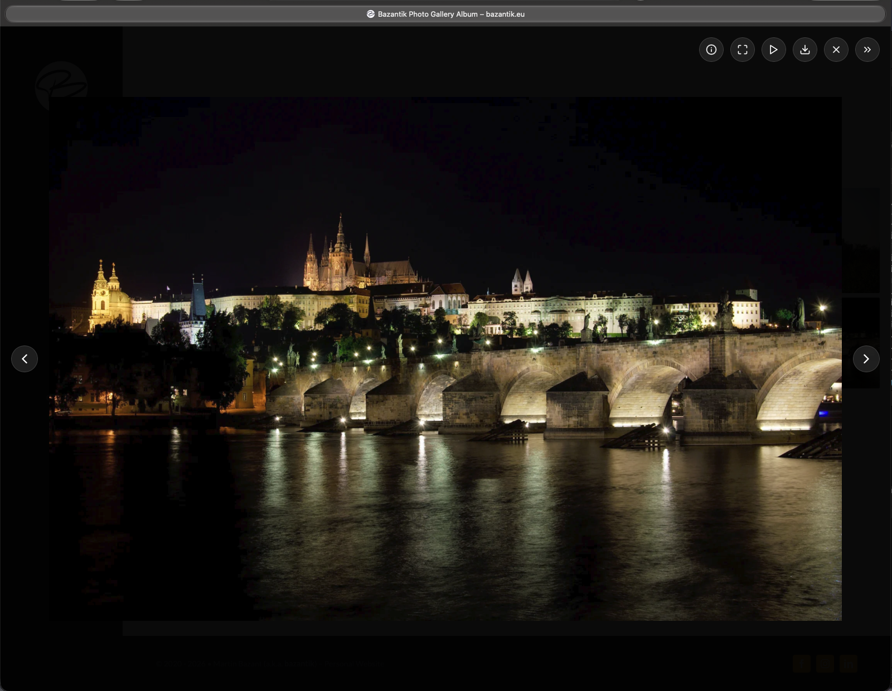
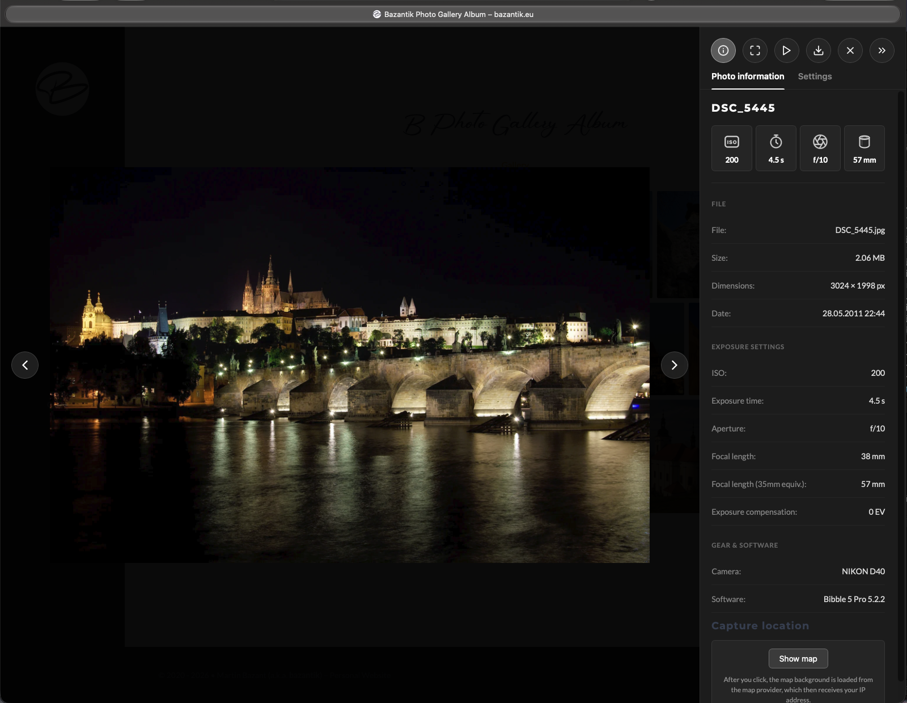
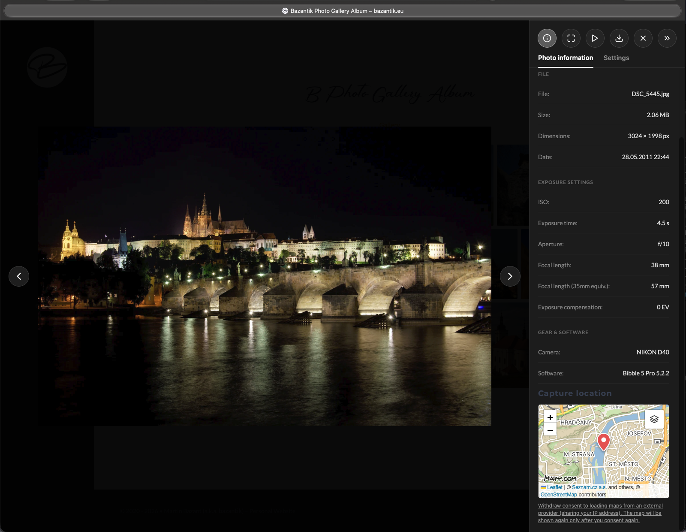
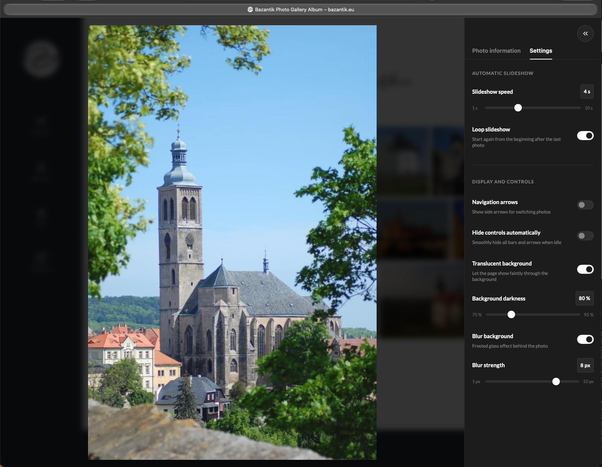
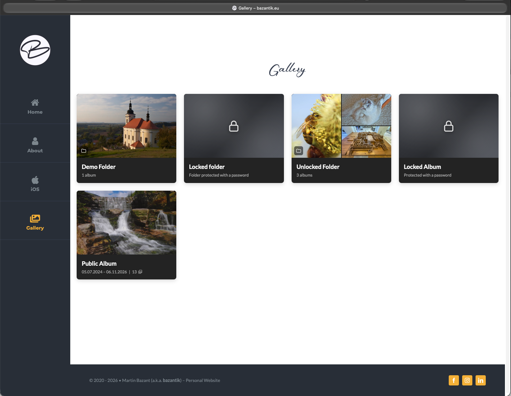
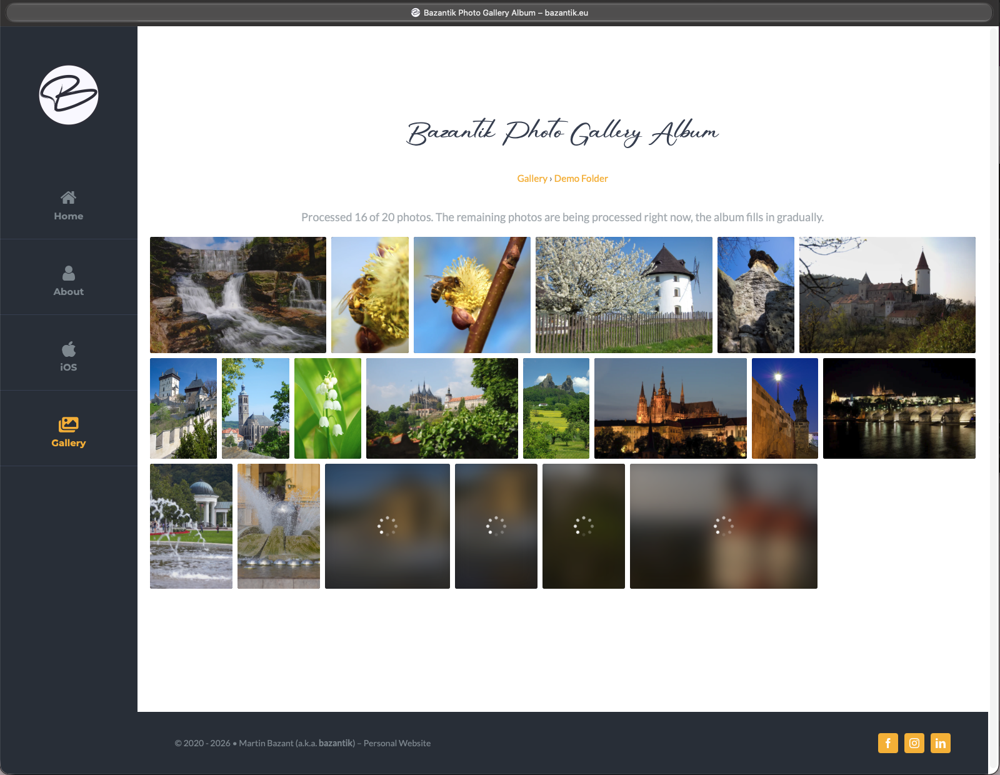
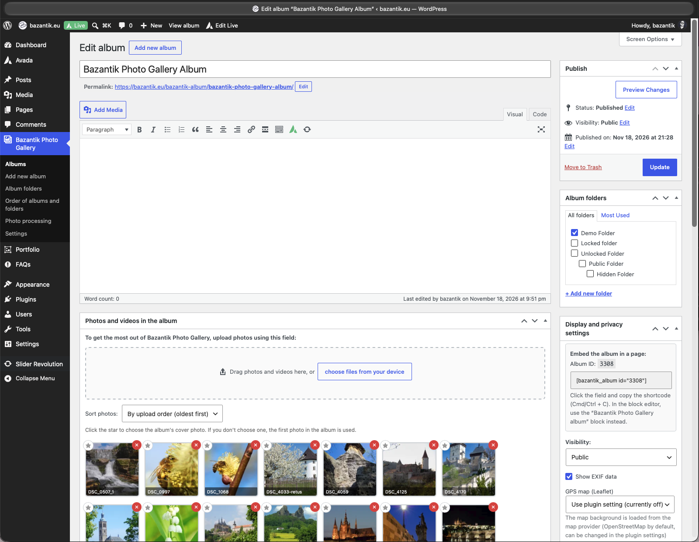
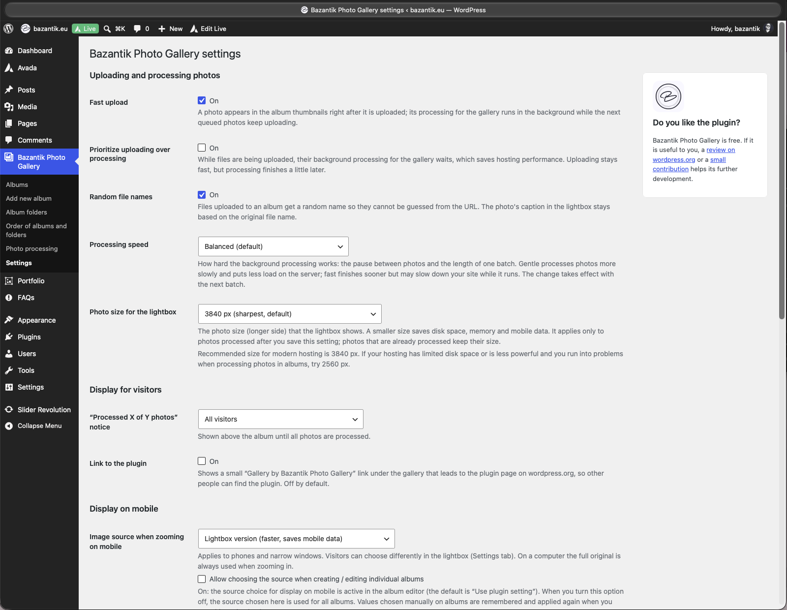

# Bazantik Photo Gallery

Self-hosted photo gallery for WordPress with folders, albums and private albums, a full-screen lightbox, EXIF data, maps and background processing of large uploads.

- WordPress.org: https://wordpress.org/plugins/bazantik-photo-gallery/
- Live demo: https://bazantik.eu/bazantik-folder/demo-folder/

Requires WordPress 6.3+ and PHP 8.1+. See `readme.txt` for the full description, FAQ and external services.

## Screenshots

*Album page with a justified photo grid that keeps every photo's original proportions.*

*Lightbox with a top toolbar (info, fullscreen, slideshow, download, close, collapse) and navigation arrows.*

*Lightbox side panel with the photo's EXIF data.*

*The same side panel with a map showing where the photo was taken.*

*Lightbox settings: slideshow speed and loop, navigation arrows, auto-hiding controls, translucent and blurred background.*

*Gallery archive with folders and albums.*

*Photos being processed in the background: finished photos are shown, the rest appear as blurred placeholders and fill in automatically.*

*Album editor with drag and drop upload, sorting, cover selection and visibility settings.*

*Plugin settings page.*

## Support

If you find the plugin useful, you can support its development on [Ko-fi](https://ko-fi.com/bazantik).

## License

GPL v2 or later. See `LICENSE`.
